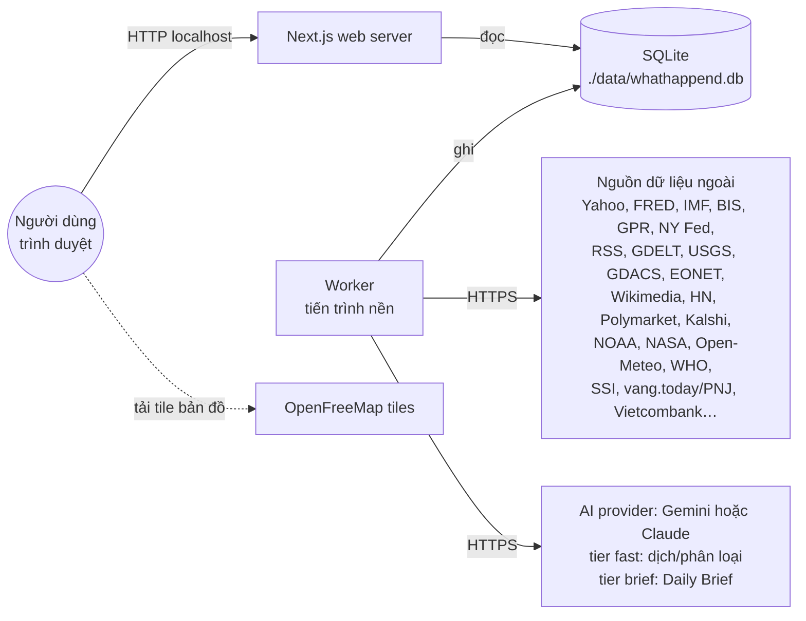

# HLDD — High Level Design Document

> Phiên bản 0.3 · Ngày 2026-10-31 · Trạng thái: Đã triển khai (M1–M7), AI đã chạy thật với Gemini
> Liên quan: [BRD](../../BRD/README.md) · [LLDD](../LLDD/README.md) · [NFR](../../BRD/03-non-functional-requirements.md)

## 1. Mục đích và phạm vi

Tài liệu này mô tả kiến trúc tổng thể của **WhatHappend**, dashboard cá nhân tổng hợp tình hình thế giới. Yêu cầu nghiệp vụ nằm trong [BRD](../../BRD/README.md); chi tiết thiết kế từng phần nằm trong [LLDD](../LLDD/README.md).

Phạm vi gồm:
- thu thập dữ liệu từ 33 nguồn đã đăng ký (30 nguồn dữ liệu ngoài + 3 bước AI: `translate`, `brief`, `insights`);
- lưu vào SQLite cục bộ;
- render dashboard song ngữ bằng Next.js;
- dùng một mô hình AI để dịch, phân loại và tóm tắt. Provider cấu hình được: Google Gemini hoặc Anthropic Claude (ADR-10).

## 2. Sơ đồ ngữ cảnh



**Nguyên tắc cốt lõi:** web server **không bao giờ** gọi API bên ngoài khi xử lý request. Chỉ worker gọi API ngoài và chỉ worker nắm API key. Ngoại lệ duy nhất: trình duyệt tự tải tile bản đồ công khai.

## 3. Kiến trúc

```
┌──────────────────────── Worker process (npm run worker) ────────────────────────┐
│  tick 20s ─► registry (lib/sources/index.ts) ─► isDue? ─► runSource()           │
│                  │                                         │                    │
│                  ▼                                         ▼                    │
│        lib/sources/<id>.ts  ──fetch + zod──►  lib/sources/store.ts (upsert)     │
│        lib/ai/*             ──AI provider──►  articles.title_vi, briefs         │
└──────────────────────────────────────────────────────┬──────────────────────────┘
                                                       │ WAL
                                              ┌────────▼────────┐
                                              │  SQLite (node:sqlite)
                                              └────────┬────────┘
┌──────────────────────── Web process (npm run dev / start) ───────┴───────────────┐
│ proxy.ts (/ → /vi) ─► app/[lang]/layout.tsx ─► app/[lang]/page.tsx               │
│   Panel (frame tĩnh) ─► <Suspense> ─► Server Component ─► lib/queries.ts         │
│                                         (await connection() + SQL đồng bộ)       │
│   Client: MarketClocks, ThemeToggle, LangSwitch, AutoRefresh, Tabs, NewsList,    │
│           MapView, LineChart/DumbbellChart, TileDetail, BriefRefresh             │
│   Route handlers: POST /api/brief (cờ kv) · GET /api/series/[key] ·              │
│                   POST /api/watchlist   (chỉ đọc/ghi SQLite cục bộ)              │
└──────────────────────────────────────────────────────────────────────────────────┘
```

## 4. Các thành phần

| Thành phần | Vị trí | Trách nhiệm |
|---|---|---|
| Scheduler (worker) | `worker/index.ts` | Mỗi 20 giây duyệt registry, chạy những nguồn đến hạn và chưa đang chạy |
| Registry nguồn | `lib/sources/index.ts`, `config/sources.ts` | Danh sách `Source`. `SOURCE_META` khai báo chu kỳ, env bắt buộc và cờ `needsAi` (dùng chung với web) |
| Fetcher | `lib/sources/<id>.ts` | Gọi API, kiểm tra bằng zod, chuẩn hóa dữ liệu, gọi store |
| Runner | `lib/sources/runner.ts` | `runSource`, `isDue`, `missingEnv`; ghi `source_status` và `fetch_log` |
| HTTP helpers | `lib/sources/http.ts` | `fetchJson`/`fetchText`/`fetchBuffer` (timeout, retry, UA), `parseCsv` |
| Store | `lib/sources/store.ts` | Upsert series/quotes, thay snapshot items/events, `hashId`, `dayTs` |
| DB | `lib/db/index.ts` | Mở SQLite (singleton), PRAGMA, tạo schema, helper `tx` |
| Data readers | `lib/data/series.ts` | SQL thuần dùng chung cho UI và worker: `getPoints`, `getTile`, `getDetailPoints`, `getWatchlistKeys` |
| Query layer | `lib/queries.ts` | Các hàm đọc cho UI (`getPanelStatus`, `getTiles`, `getNews`, `getCalendar`, `requestNow`…), luôn gọi `await connection()` trước |
| Route handlers | `app/api/{brief,series/[key],watchlist}/route.ts` | Yêu cầu viết lại brief (chỉ ghi cờ `kv`), lịch sử series cho hộp thoại chi tiết, ghim/bỏ ghim watchlist |
| AI config | `lib/ai/config.ts` | Đọc `AI_PROVIDER`, `AI_API_KEY`, `AI_MODEL_BRIEF`, `AI_MODEL_FAST` (không import SDK, web cũng dùng): `aiStatus()`, `isAiConfigured()` |
| AI provider | `lib/ai/provider.ts`, `lib/ai/providers/{gemini,anthropic}.ts` | `generateJson({ tier, system, user, schema })`, kết quả kiểm bằng zod; adapter Gemini (`@google/genai`) và Claude (`@anthropic-ai/sdk`) |
| AI pipeline | `lib/ai/{translate,brief,brief-shared,taxonomy}.ts` | Nguồn `translate`: dịch và phân loại tiêu đề (tier `fast`). Nguồn `brief`: Daily Brief (tier `brief`) |
| Signals | `lib/signals/risk-regime.ts` | Tính Risk Regime từ các series (xem [LLDD 06](../LLDD/06-risk-regime.md)) |
| UI | `app/[lang]/*`, `components/panels/{MarketPanels,ContentPanels,WorldPanels}.tsx` (+ client `MapView`, `NewsList`, `BriefRefresh`), `components/ui/{Panel,Tabs,MarketClocks,ThemeToggle,LangSwitch,AutoRefresh}.tsx`, `components/charts/{KpiTile,Sparkline,LineChart,DumbbellChart,TileDetail}.tsx` | Layout, Panel, các panel nghiệp vụ, biểu đồ, bản đồ, hộp thoại chi tiết + watchlist |
| Theme hook | `lib/use-theme.ts` | `useSyncExternalStore` trên `<html data-theme>` |
| Build helper | `scripts/copy-maplibre-worker.mjs` | Chép worker MapLibre vào `public/vendor/` (hook `predev`/`prebuild`, xem ADR-09) |
| i18n | `lib/i18n.ts`, `messages/{vi,en}.json` | Từ điển, `hasLocale`, `getDict`, `intlLocale` |
| CLI | `scripts/fetch.ts` | Chạy tay một hoặc nhiều nguồn để kiểm thử |

## 5. Luồng dữ liệu theo nhóm

| Nhóm | Nguồn (chi tiết ở LLDD 02) | Bảng đích | Ghi chú |
|---|---|---|---|
| Thị trường | Yahoo (qua `yahoo-finance2`), SSI (VN-Index) | `quotes` (giá mới nhất) và `observations` (lịch sử ngày) | Sparkline 30 ngày đọc từ `observations` |
| Vĩ mô | FRED (CSV, không cần key), IMF, BIS, GPR, GSCPI | `observations` (`series_id` = `fred:DGS10`…) | Giá trị mới nhất = điểm cuối của series |
| Tin tức | RSS, GDELT | `articles` | Loại trùng theo `id` (hash URL) và `title_key`. Sau đó AI điền `title_vi`/`title_en`, `region`, `topic` |
| Bản đồ | USGS, GDACS, EONET, GDELT (events export) | `events` | USGS/GDACS/EONET thay snapshot theo `source` và giữ `title_vi` đã dịch. GDELT upsert theo ô lưới 1° và xóa ô cũ hơn 24 giờ |
| Danh sách | Wikipedia, HN, Polymarket, Kalshi, lịch kinh tế, launches, WHO, chất lượng không khí, vàng VN, Vietcombank | `items` (theo `kind`) | Thay toàn bộ snapshot theo `kind`. Lịch FOMC không lưu DB mà lấy từ `config/fomc.ts` |
| Crypto | Yahoo (BTC, ETH, SOL), CoinGecko, alternative.me, Deribit, DefiLlama, mempool.space, Binance (futures + P2P), RSS báo crypto | `quotes`, `observations`, `items`, `articles` | Trang riêng `/[lang]/crypto`. Báo crypto không vào tin thế giới và Brief |
| Watchlist | Người dùng ghim từ hộp thoại chi tiết | `watchlist` (`series_id` = `SeriesKey`) | Ghi qua `POST /api/watchlist` (ngoại lệ ghi duy nhất của web cùng với cờ `kv` của brief) |
| AI Brief | Tin 24h qua + Vital Signs + sự kiện | `briefs` (`date`, `lang`) | 06:00 Asia/Ho_Chi_Minh |
| Vận hành | Mọi nguồn | `source_status`, `fetch_log` | Cơ sở để tính stale trên từng panel |

## 6. Công nghệ (phiên bản đã cài)

| Hạng mục | Công nghệ |
|---|---|
| Runtime | Node.js 26; `node:sqlite` có sẵn (SQLite 3.53) |
| Web framework | Next.js 16.4.3 App Router, bật `cacheComponents` và `partialPrefetching`; React 19.3 |
| Ngôn ngữ | TypeScript 5.9 (strict) |
| CSS | Tailwind CSS 4.3 (`@tailwindcss/turbopack`); design token bằng CSS custom properties |
| Biểu đồ | Recharts 3.10 |
| Bản đồ | MapLibre GL 6.16 + react-map-gl 8.1, tile OpenFreeMap |
| Kiểm tra dữ liệu | zod 4.6 |
| Nguồn dữ liệu | rss-parser 3.13, yahoo-finance2 4.0.5, xlsx 0.20.3 (SheetJS, cài từ `cdn.sheetjs.com`, để đọc file `.xls` của GPR) |
| AI | @google/genai 2.32.0 (mặc định `gemini-flash-latest`, `gemini-flash-lite-latest`) và @anthropic-ai/sdk 1.3 (`claude-sonnet-5-5`, `claude-haiku-5-5`); chọn qua `AI_PROVIDER` (ADR-10) |
| Chạy worker/script | tsx 4.23 (hỗ trợ alias `@/` từ tsconfig) |
| Quản lý gói | npm 11 |
| Tiện ích | clsx |

## 7. Triển khai và runtime

- **Một máy, hai tiến trình:**
  1. Web: `npm run dev` khi phát triển, hoặc `npm run build && npm run start`.
  2. Worker: `npm run worker` = `node --env-file-if-exists=.env.local --import tsx worker/index.ts` (có nạp `.env.local`).
  3. Hoặc chạy cả hai: `npm run dev:all`. Các script khác: `npm run fetch -- <id…|all>`, `npm run typecheck`.
- **Dữ liệu:** file `./data/whathappend.db` (đổi được qua `DB_PATH`), chế độ WAL nên hai tiến trình đọc/ghi song song được.
- **Cấu hình:** `.env.local` (theo mẫu `.env.example`; gitignore, quyền 600). Biến AI cho `translate` và `brief`:
  - `AI_PROVIDER` (`gemini` | `anthropic`, tùy chọn) và `AI_API_KEY`. Cũng nhận `GEMINI_API_KEY`/`GOOGLE_API_KEY`/`ANTHROPIC_API_KEY`.
  - Tùy chọn `AI_MODEL_BRIEF`, `AI_MODEL_FAST` và `DB_PATH`.
  - Sau khi sửa `.env.local` phải khởi động lại **cả worker lẫn web**. Mọi nguồn dữ liệu khác đều không cần key: FRED dùng CSV công khai, chất lượng không khí dùng Open-Meteo.
- **Build hooks:** `predev`/`prebuild` chạy `scripts/copy-maplibre-worker.mjs`; `public/vendor/` nằm trong `.gitignore` và được ESLint bỏ qua.
- **Không dùng:** Frankfurter (Yahoo đã có tỷ giá), World Bank (IMF đủ, World Bank rất chậm khi chưa có cache), Reddit (bị chặn khi không đăng nhập). Xem [LLDD 02](../LLDD/02-data-sources.md) §Nguồn đã loại.
- **Docker (tùy chọn, chạy trên một máy):** `Dockerfile` dựng một image (`npm ci` + `next build`) dùng cho cả hai service trong `compose.yaml`: `web` (`next start`, cổng `127.0.0.1:3000`) và `worker` (`node --import tsx worker/index.ts`). Hai service dùng chung volume `data` chứa file SQLite. Dùng volume thay cho bind mount `./data` vì WAL cần mọi tiến trình trên cùng một filesystem. `.env.local` được nạp lúc chạy qua `env_file`, không nằm trong image.
- **Không có** đám mây hay CI ở phiên bản này.

## 8. Các vấn đề xuyên suốt

| Vấn đề | Cách xử lý |
|---|---|
| i18n | Route `app/[lang]` với `generateStaticParams` cho `vi`/`en`. `proxy.ts` chuyển `/` sang `/vi`. Từ điển JSON được kiểm kiểu (thiếu khóa là lỗi biên dịch). Nội dung động có cột `title_vi`/`title_en` |
| Theme | `data-theme` trên `<html>` được gán bởi script inline trước khi vẽ trang. Client đọc theme qua `useTheme()` (`useSyncExternalStore`), bản đồ đổi style theo theme. Token màu sáng/tối trong `app/globals.css`, dùng bảng màu dataviz đã kiểm định |
| Cô lập lỗi | Mỗi nguồn chạy độc lập. Lỗi được ghi vào `source_status` và không lan ra ngoài. Mỗi panel bọc `<Suspense>` riêng |
| Staleness | `getPanelStatus` so `last_ok` với 3 × `intervalMs` từ `SOURCE_META`, đồng thời kiểm tra lần chạy gần nhất có lỗi không |
| Bí mật | Key AI chỉ nằm trong `.env.local` và chỉ được dùng trong worker. Web chỉ kiểm tra cấu hình hợp lệ hay không (`isAiConfigured()`) để hiện "Cần API key"; route `/api/brief` chỉ ghi cờ, không gọi AI. Không gửi key xuống trình duyệt |
| Tính thuần khi render | Không gọi `Date.now()`/`setState` trong lúc render hay effect: thời gian request lấy từ `requestNow()`, đồng hồ và theme là external store |
| Rate limit | Chu kỳ mỗi nguồn khai báo trong `SOURCE_META`. Retry 1 lần với 5xx/429. Thời điểm chạy dựa trên DB nên restart không gây gọi dồn |
| Logging | Worker in ra console; `fetch_log` giữ 7 ngày lịch sử chạy (ok, count, error, duration) |
| Làm mới UI | `AutoRefresh` (client) gọi `router.refresh()` mỗi ~60 giây và khi tab được hiện lại |

## 9. Quyết định kiến trúc (ADR-lite)

Các quyết định dưới đây **khác với kế hoạch ban đầu** hoặc cụ thể hóa kế hoạch.

### ADR-01 — `node:sqlite` thay cho Drizzle + better-sqlite3
- **Bối cảnh:** better-sqlite3 là native addon. Nó cần install script, trong khi tính năng `allowScripts` của npm 11 chặn install script. Nó cũng cần binary build sẵn cho Node 26.
- **Quyết định:** dùng `node:sqlite` có sẵn trong Node, viết SQL thuần kèm vài helper có kiểu (`getDb`, `tx`, store helpers).
- **Hệ quả:**
  - Không có dependency native nào.
  - Tài liệu Next.js coi `node:sqlite` là nguồn đồng bộ, có thể dự đoán.
  - Mất phần migration và type inference của ORM, bù lại bằng schema `CREATE TABLE IF NOT EXISTS` tập trung trong `lib/db/index.ts`.

### ADR-02 — i18n bằng từ điển có sẵn của Next.js thay cho next-intl
- **Bối cảnh:** Next 16.4 với Cache Components còn mới; next-intl có rủi ro tương thích.
- **Quyết định:** dùng `app/[lang]`, `generateStaticParams`, JSON dictionaries và `proxy.ts`.
- **Hệ quả:** ít dependency hơn. Không có ICU plural/format phức tạp; định dạng số/ngày tự làm bằng `Intl`.

### ADR-03 — Scheduler tick-based thay cho node-cron
- **Bối cảnh:** cần chu kỳ riêng cho mỗi nguồn và không muốn gọi dồn API sau khi restart.
- **Quyết định:**
  - Cứ 20 giây kiểm tra "đến hạn" dựa trên `source_status.last_run` trong DB.
  - Sau lỗi thì retry sau `max(1 phút, chu kỳ/4)`.
  - Brief dùng `isDue` riêng để chạy lúc 06:00.
- **Hệ quả:** không thêm dependency; lịch chạy bền qua các lần restart. Độ chính xác thời gian khoảng ±20 giây là đủ.

### ADR-04 — Worker là tiến trình riêng
- **Bối cảnh:** API bên ngoài chậm và hay lỗi; key cần được giữ kín.
- **Quyết định:** chỉ worker gọi API ngoài và AI; web chỉ đọc DB.
- **Hệ quả:** trang nhanh, ổn định và có lịch sử dữ liệu. Đổi lại phải chạy 2 tiến trình.

### ADR-05 — Cache Components: `connection()` và `<Suspense>`
- **Bối cảnh:** khi bật `cacheComponents`, truy vấn SQLite đồng bộ sẽ bị prerender lúc build và đóng băng dữ liệu.
- **Quyết định:**
  - Mọi hàm trong `lib/queries.ts` gọi `await connection()` trước khi truy vấn.
  - Phần thân mỗi panel được bọc `<Suspense>`.
  - `AutoRefresh` gọi `router.refresh()` khoảng mỗi 60 giây.
- **Hệ quả:** khung trang tĩnh hiện ngay, dữ liệu stream vào theo từng panel.

### ADR-06 — npm thay cho pnpm
- **Bối cảnh:** máy không cài pnpm.
- **Quyết định:** dùng npm; lệnh là `npm run <script>`.
- **Hệ quả:** không cần cài thêm công cụ toàn cục.

### ADR-07 — Font hệ thống thay cho Geist
- **Bối cảnh:** Geist có thể thiếu dấu tiếng Việt (Latin Extended Additional); hướng dẫn dataviz cũng khuyên dùng sans hệ thống.
- **Quyết định:** dùng `system-ui, -apple-system, "Segoe UI", Roboto, sans-serif`.
- **Hệ quả:** dấu tiếng Việt hiển thị chuẩn và không tốn tải font.

### ADR-08 — Bảng màu dataviz đã kiểm định
- **Bối cảnh:** biểu đồ cần an toàn cho người mù màu và có chế độ tối.
- **Quyết định:**
  - 8 màu series (`--s1`…`--s8`) theo đúng thứ tự đã kiểm định.
  - 4 màu trạng thái (`--good`, `--warning`, `--serious`, `--critical`) và các màu ink/surface, mỗi màu có bước riêng cho sáng và tối.
  - `data-theme` được gán trước khi vẽ trang.
- **Hệ quả:** không được tự đổi thứ tự hay màu; nếu đổi thì phải chạy lại bộ kiểm định.

### ADR-09 — Tự phục vụ worker của MapLibre
- **Bối cảnh:** MapLibre GL 6 xác định URL worker qua `import.meta.url`. Khi bundle bằng Turbopack, URL này không còn trỏ đúng file, bản đồ chỉ hiện nền xám và console báo "Worker failed to load".
- **Quyết định:** `scripts/copy-maplibre-worker.mjs` chép `node_modules/maplibre-gl/dist/maplibre-gl-worker.mjs` (tự chứa, không import gì) vào `public/vendor/`; chạy tự động qua `predev`/`prebuild`. `MapView` gọi `setWorkerUrl("/vendor/maplibre-gl-worker.mjs")` trước khi tạo map.
- **Hệ quả:** bản đồ chạy được với Turbopack mà không đổi cấu hình bundler. `public/vendor/` là sản phẩm build: gitignore và ESLint bỏ qua. Khi nâng cấp maplibre-gl, file được chép lại ở lần `dev`/`build` kế tiếp.

### ADR-10 — Lớp AI không phụ thuộc provider
- **Bối cảnh:** Người dùng muốn key AI cấu hình được và muốn dùng Gemini. Bản trước gắn cứng Claude: chỉ nhận `ANTHROPIC_API_KEY`, gọi trực tiếp SDK Anthropic.
- **Quyết định:**
  - Thêm một lớp adapter mỏng trên SDK chính thức của từng provider: `generateJson({ tier, system, user, schema })`, với adapter `gemini` (`@google/genai`) và `anthropic` (`@anthropic-ai/sdk`).
  - Zod là **hợp đồng duy nhất**. Cùng một schema vừa sinh JSON Schema cho đầu ra có cấu trúc (Gemini `responseJsonSchema`, Claude `zodOutputFormat`), vừa kiểm tra kết quả.
  - Cấu hình nằm trong `lib/ai/config.ts`, file không import SDK để web dùng được: `AI_PROVIDER`, `AI_API_KEY` (đoán provider từ key), `AI_MODEL_BRIEF`, `AI_MODEL_FAST`. Mỗi provider có model mặc định riêng.
  - Nguồn AI khai báo `needsAi` thay cho `requiresEnv`.
- **Hệ quả:**
  - Phải cài 2 SDK; prompt dùng chung cho cả hai provider.
  - Mặc định Gemini là Flash/Flash-Lite, vì gói miễn phí không có hạn mức cho Pro (đã kiểm chứng 429 `limit: 0`).
  - Đã chạy thật với Gemini ngày 2026-10-31; adapter Claude mới qua kiểm tra kiểu.
  - Thêm provider mới chỉ cần thêm 1 adapter và 1 nhánh trong `config.ts`. Chi tiết ở [LLDD 05](../LLDD/05-ai-pipeline.md).

## 10. Rủi ro và giảm thiểu

| Rủi ro | Mức | Giảm thiểu |
|---|---|---|
| Endpoint không chính thức (Yahoo, SSI, vang.today, PNJ, Vietcombank) thay đổi hoặc bị chặn | Cao | Kiểm tra bằng zod; cô lập lỗi; badge stale; mỗi nguồn nằm trong 1 file nên thay nguồn dễ |
| Bị giới hạn tần suất gọi (Launch Library 15 lần/giờ, Vietcombank, ForexFactory…) | Trung bình | Chu kỳ dè dặt trong `SOURCE_META`; retry 1 lần; thời điểm chạy dựa trên DB |
| Chi phí AI tăng | Thấp–TB | Model `fast` gửi theo lô, mỗi tiêu đề dịch 1 lần; Brief 1 lần/ngày; key tùy chọn; có thể dùng Gemini gói miễn phí |
| Hạn mức hoặc quá tải của provider AI (429 hết hạn mức, 503 "high demand") | Trung bình | Mặc định Flash/Flash-Lite (Pro có hạn mức miễn phí 0); SDK Gemini thử lại 4 lần với 5xx; 429 để bộ lập lịch thử lại; brief cũ vẫn hiện kèm badge stale |
| Chất lượng dịch hoặc tóm tắt sai | Trung bình | Luôn kèm link bài gốc; prompt ràng buộc chỉ dùng dữ liệu đầu vào; có ghi chú miễn trừ |
| Tranh chấp khóa SQLite giữa 2 tiến trình | Thấp | WAL + `busy_timeout = 5000`; ghi theo transaction ngắn (`BEGIN IMMEDIATE`) |
| Next.js 16.4 có API mới hoặc khác so với hiểu biết cũ | Trung bình | Đọc tài liệu đi kèm trong `node_modules/next/dist/docs/` trước khi code |
| Dữ liệu nhiễu: điểm nóng GDELT gán sai địa điểm, top vi.wikipedia bị bot đẩy lượt xem | Trung bình | Chỉ lấy mã sự kiện 14/18/19/20, gom ô 1°, giữ 60 ô nhiều lượt nhắc nhất; tab Wikipedia mặc định là EN |
| DB phình to | Thấp | `fetch_log` giữ 7 ngày; `rss` xóa bài cũ hơn 14 ngày; events/items thay theo snapshot; GDELT xóa ô cũ hơn 24 giờ |
